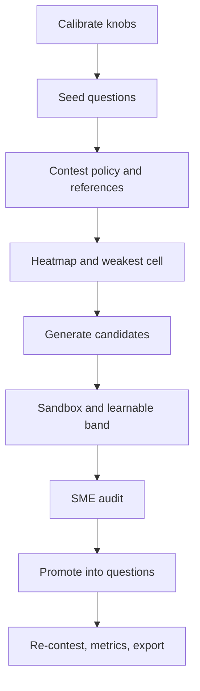

# Implementation notes

## High level and main goal

Frontier Lens is an RL data engine for one open-weight **policy** model. It builds execution-verified tasks, scores the policy against other open models, then writes new tasks aimed at the policy's weak spots. Held-out eval tasks are built without looking at the policy.

The product is **RL-ready** JSONL: a prompt, a sandbox gold answer, and a pinned reward id (`exact_match_v2`). A training run that improves the policy was not done. These notes describe the pipeline that exists in the code, in the order the commits built it.

Roles in `models.yaml`:

| Role | Model | Samples |
|---|---|---|
| Policy | `gemma4-26b-a4b` | k=8 |
| References | Gemma 31B, Qwen, DeepSeek, Llama | k=3 |
| Generator | `glm-5.3` | not scored in the contest |

## Low level, details, and data flow

Each stage has its own file. This index does not repeat them.

1. [Seed generation](01-seed-generation.md) — calibrate difficulty knobs, materialize procedural items, store sandbox keys, split train from eval.
2. [Model evaluation](02-model-evaluation.md) — contest the policy and references, grade the last `FINAL:` line, mark weak heatmap cells.
3. [Regenerated samples](03-regenerated-samples.md) — ask the generator for new items in the weakest cell, reject broken or out-of-band train items, audit, then promote.
4. [Success versus seed](04-success-vs-seed.md) — the gates that make regenerated data better training fuel, and the comparison that is reported but not required.

