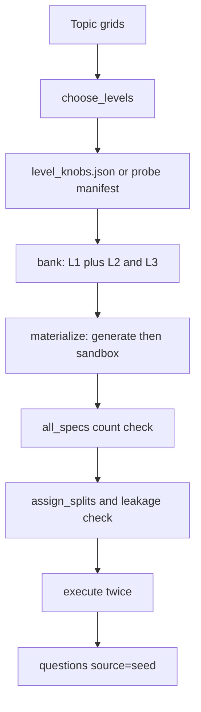

# Seed generation

## High level and main goal

The seed bank is the starting set of original tasks. Every item has a gold answer produced by running code in a sandbox, not by a model. Train and eval use the same difficulty knobs but disjoint seeds, so a template never sits in both splits.

The outcome is rows in `questions` with `source='seed'`, a deterministic stdout key, and a split of `harness`, `train`, or `eval`.

Command:

```bash
uv run python -m frontier_lens.calibrate --live   # optional; measures the policy
uv run python -m frontier_lens.seed --force
```

CI can seed without an API key. It uses a synthetic difficulty curve unless `FRONTIER_LENS_REQUIRE_LIVE_KNOBS=1`.

## Low level, details, and data flow

### Difficulty knobs

`calibrate.py` keeps a six-point grid per topic, ordered easy to hard. The primary knob grows along the grid: Python `steps` (28..100), shell `rows` (80..320), counting `length` (8..12), units `steps` (10..20). Python also raises aliasing and cross-container copies; counting adds interacting constraints (parity, order, modular counts).

`choose_levels` picks two indices from a pass-rate curve:

- **L2** is a point in `[0.2, 0.8]`, closest to 0.5, that still has a later point with a lower rate.
- **L3** is the hardest later point under 0.2 when one exists. Otherwise it is the hardest later point that is still below L2.

`--live` runs the policy (k=8) on one probe item per grid point and writes `data/level_knobs.json` with the policy id, k, timestamp, rates, and chosen indices. Without that file, `probe_manifest()` uses the synthetic curve `PROBE_RATES = [0.95, 0.80, 0.50, 0.35, 0.15, 0.05]`.

L1 is not on this grid. Each topic has two fixed harness items.

### Procedural bank

Four families implement `generate(seed, **knobs)` and expose `specs()`:

- `shell_pipelines`
- `python_state`
- `multi_step_units`
- `constraint_counting`

`procedural.bank` builds the inventory:

| Level | Band | Count per topic | Seeds | Template |
|---|---|---|---|---|
| L1 | harness | 2 | fixed | topic harness |
| L2 | standard | 8 train + 4 eval | train `0..7`, eval `10000..10003` | `{topic}_train` / `{topic}_eval` |
| L3 | hard | 8 train + 4 eval | same ranges, harder knobs | `{topic}_train` / `{topic}_eval` |

That is 2 + 12 + 12 = 26 items per topic, and 104 items overall. `all_specs()` raises if any `(topic, level)` count is wrong.

`materialize` calls `generate`, runs the sandbox, and retries at `seed + 1000` up to five times. It drops a try when execution fails, stdout is empty, or the gold answer appears inside the stem. Accepted specs store `seed`, `origin_seed`, `seed_range`, and knob lineage (`knob_source`, `knob_policy`, `knob_k`, `knob_grid_index`).

### What the model will see

Python and shell put the program or pipeline in the stem (`python_stem`, `shell_stem`). Counting and units use `hidden_stem`: the model sees the problem in prose. The verifier code still runs to produce the key, and it is stored, but it is not shown.

### Keys, ids, and splits

`seed()` calls `execute(..., twice=True)`. The two runs must match. Stdout becomes `questions.key`.

The question id is a 16-character SHA-256 of template, params, code, and input files (`ids.item_id`). Rebuilding the same spec keeps the same id.

`split.rl_split`:

- level 1 → `harness`
- template in `EVAL_TEMPLATES` (`shell_pipelines_eval`, `python_state_eval`, `constraint_counting_eval`, `multi_step_units_eval`) → `eval`
- otherwise → `train`

`assign_splits` raises if any template name appears in both train and eval. `--force` deletes existing `source='seed'` rows and inserts the new bank. Generated questions are left in place.

### Data flow


