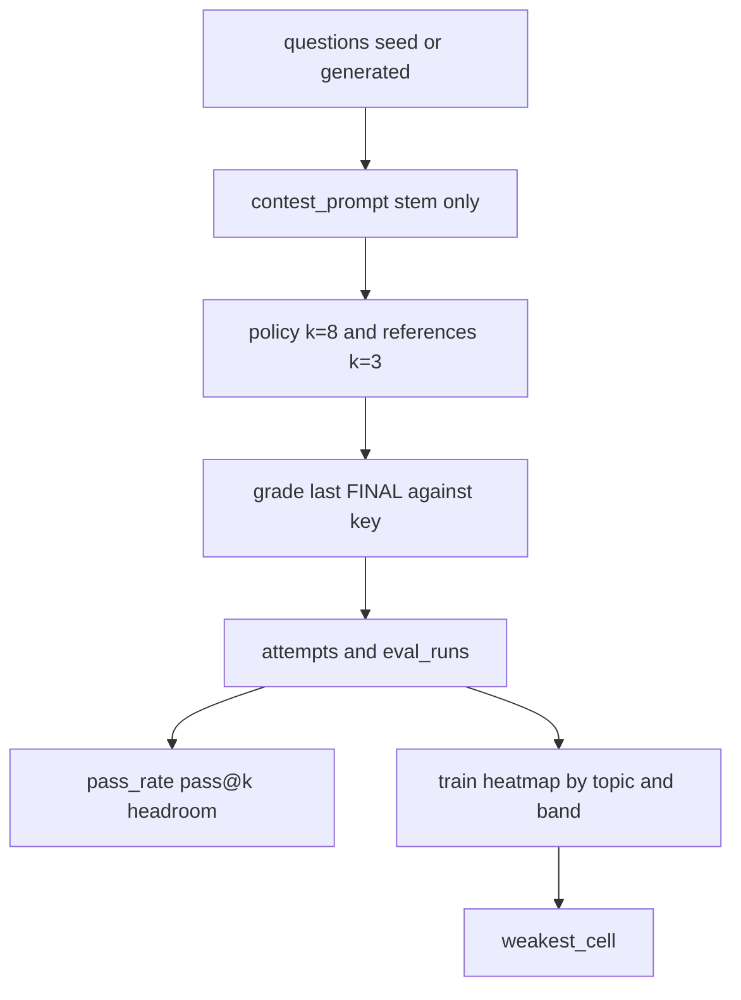

# Model evaluation

## High level and main goal

Evaluation asks the policy and the reference models the same questions and scores them against the sandbox key. The policy is sampled more often so a single item can show a pass rate, not just a lucky hit.

The outcome is an `eval_runs` row, one `attempts` row per sample, and a train-split heatmap. The weakest cell is the input to generation.

The generator is not a contestant. It writes tasks later. It does not answer them here.

```bash
uv run python -m frontier_lens.contest --live
```

`--write-fixtures` saves answers for replay. Replay reads `fixtures/recorded_run.json` and does not call a model.

## Low level, details, and data flow

### Who is scored

`contest.run_contest` loads models from `models.yaml` and keeps `role in {policy, reference}`.

| Role | Default k | Override |
|---|---|---|
| Policy | `POLICY_K` = 8 | `--k` |
| Reference | `REFERENCE_K` = 3 | `--k` |

Questions come from `questions` where `source IN ('seed', 'generated')`. Level filters apply. There is no split filter: harness, train, and eval items in the selected levels are all scored. The heatmap later restricts itself to `split='train'`.

### What the model sees

`contest_prompt` sends the stem only. The model must end with `FINAL: <answer>`. It does not receive `code`, input files, or `key`.

For counting and units, the stem is prose, so the verifier stays hidden. For Python and shell, the program is part of the stem. The key is still the sandbox stdout stored at seed or promotion time, not a second model judgment.

### Reward

`reward.grade` implements `exact_match_v1`:

1. Take the **last** `FINAL:` line. Earlier lines do not count.
2. No `FINAL:` line → reward 0, `unparsable=1`.
3. A hedge or multi-answer (`or`, `either`, `/`, a comma, or ` and `) → reward 0.
4. Otherwise normalize and compare to the gold key. Match → reward 1.

`is_correct` is 1 only when the reward is 1. Each attempt stores `raw_output`, `parsed_answer`, `is_correct`, `unparsable`, latency, and token counts. `runlog` also writes `logs/{run_id}.jsonl` with the prompt, raw output, gold key, and reward.

### Item stats

The unit of analysis is the item. k samples of one item are not k independent items.

From `stats.py`, for `c` correct out of `n` samples:

- `pass_rate = c / n`
- `pass@k = 1 - C(n-c, k) / C(n, k)` (unbiased)
- `headroom = pass@k - pass@1`
- learnable band: `0 < pass_rate < 1` (0 and 1 are outside)

`metrics.policy_item_rates` computes these for one run and model, defaulting to the train split. The Weaknesses page shows the pass-rate histogram. The Results page shows band share and mean headroom.

### Weak cells

`heatmap.heatmap` groups train attempts by `(topic, band, question)`:

- An item is majority-correct when at least half the samples are correct (`sum * 2 >= n`).
- Cell accuracy is the fraction of items that are majority-correct.
- A Wilson 95% interval is computed on those item-level successes.
- `weak` is true when the cell has items and the interval's **upper** bound is strictly below the model's overall mean accuracy.

A cell whose interval overlaps the overall mean is not marked weak.

`weakest_cell` sorts cells by `(accuracy, hi)` ascending and returns the first. That cell is what the generator targets.

### Data flow


