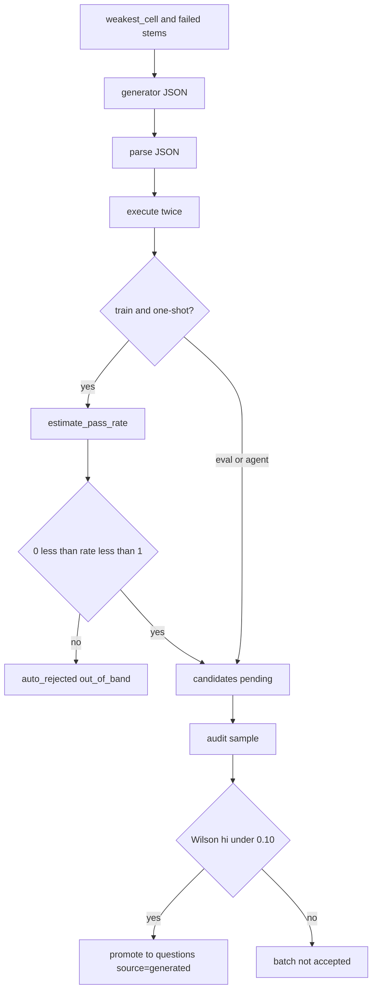

# Regenerated samples

## High level and main goal

Generation uses the policy's weakest train cell to ask for new original tasks in that topic and band. A candidate is kept only when its verifier runs twice to the same stdout. On the train split, a one-shot candidate must also be neither trivial nor impossible for the policy.

Eval candidates are a separate path. They are written for the held-out cells and the policy is never called to filter them.

The outcome is a `candidates` row, then, after audit, a `questions` row with `source='generated'`.

```bash
uv run python -m frontier_lens.generate --run RUN --model POLICY --split train
```

## Low level, details, and data flow

### Train path

`propose_one_shot(..., rl_split="train")`:

1. `weakest_cell(run_id, model_id)` picks the target `(topic, band)`.
2. `_failures` lists up to six train stems in that cell whose average `is_correct` is below 0.5.
3. The generator (`role: generator`, family disjoint from policy and references) receives `ONE_SHOT_TRAIN` and returns JSON: `stem`, `code`, `lang`, `input_files`, `numeric`.
4. `_store_candidate` runs with `calibrate=True`.

The agent path (`--mode agent`) can call tools, including `get_cell_failures`, which lists stems with accuracy below **0.67**. That threshold is looser than the one-shot list. Both paths still land in `_store_candidate`.

### Eval path

`rl_split="eval"` cycles the held-out `(topic, band)` cells from eval templates. The prompt is `ONE_SHOT_EVAL`. `calibrate=False`, so `estimate_pass_rate` is not called. Eval items are not fit to the policy's pass rate.

### Store gates

`_store_candidate` always inserts a row. Status starts as `pending`.

| Check | Failure status | Reason |
|---|---|---|
| JSON object in the model text | `auto_rejected` | `unsafe` |
| `execute(lang, code, files, twice=True)` | `auto_rejected` | sandbox reason (`timeout`, `non_deterministic`, `exec_error`, …) |
| Train + calibrate + one-shot, pass rate not in `(0, 1)` | `auto_rejected` | `out_of_band` |

`estimate_pass_rate` samples the policy k=8 times with `contest_prompt` and `grade`. It stores `policy_pass_rate` and `pass_at_k`.

One-shot train items at pass rate 0 or 1 are rejected. Agent mode records the same rate and does **not** auto-reject on the band. Eval items skip this call entirely.

An `auto_rejected` row cannot be promoted later.

### Audit and promotion

Pending candidates for a split (and optional generator mode) are tagged with an `audit_batch_id`. `draw_audit_sample` marks up to `AUDIT_SAMPLE_N` (default 50) of them for a human label. Labels are blind to generator model and mode.

Defect labels are `rejected`, `broken_item`, and `trivial`. `audit_decision` puts a Wilson 95% interval on the defect rate. The batch is accepted when the sample is non-empty and the upper bound is below `AUDIT_MAX_DEFECT_HI` (default 0.10).

If the batch is accepted, `close_audit_batch` calls `promote` on the **unsampled** pending rows in that batch with label `hard_item` and `kind='audit_auto'`.

`promote`:

- Refuses `status='auto_rejected'`.
- Writes a `reviews` row (`fair`, `novel`, `hard_for_right_reason`, label).
- Defect labels set the candidate to `rejected` and stop.
- Otherwise re-executes the code twice. A failed re-exec auto-rejects the candidate.
- On success, inserts `questions` with `source='generated'`, `template='generated'`, `reward_fn='exact_match_v1'`, level 3 when `band='hard'` else level 2, and the candidate's `rl_split`. The key is the new stdout. The candidate becomes `approved`.

Correct policy traces that still look hedged or self-contradictory go to `suspicious_samples` (`conflicting_finals`, `hedged_then_correct`). That queue is human review. It does not change the reward.

### Data flow


