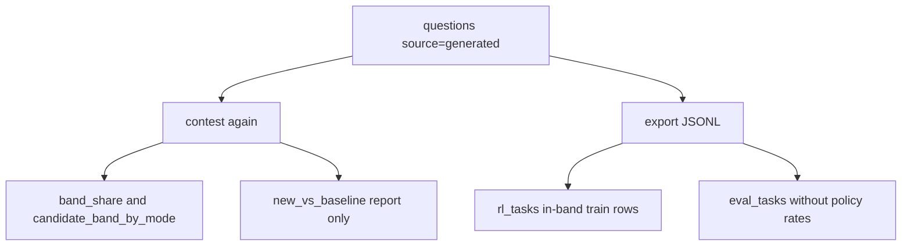

# Success versus seed

## High level and main goal

Regenerated data is better than the seed bank when it is aimed at a measured weakness, still solvable sometimes, backed by a deterministic key, and accepted by a human audit. The held-out eval set stays free of policy pass-rate fitting.

There is no rule that a generated item must have a lower accuracy than the seed item it replaces. Nothing in promotion compares the two accuracies. `new_vs_baseline` can report that comparison after a later contest. It does not gate anything.

A training run was not done. These checks say the JSONL is fit to train on. They do not say the policy improved.

## Low level, details, and data flow

### Gates

Each gate blocks a different failure. Together they are the definition of "better" in this repo.

| Gate | Where | What it requires | What it blocks |
|---|---|---|---|
| Weak-cell target | `weakest_cell` + failure stems | Train generation is conditioned on the policy's lowest `(topic, band)` cell | New items that ignore where the policy actually fails |
| Learnable band | `in_learnable_band`, one-shot only | `0 < pass_rate < 1` on k=8 policy samples | Items the policy always solves or never solves |
| Deterministic key | `execute(..., twice=True)` at store and again at promote | Two runs, same stdout, answer not rejected as unsafe | Broken verifiers and flaky gold |
| Template holdout | `split.py`, eval generation with `calibrate=False` | Eval templates and seed ranges never appear in train; eval generation does not call the policy | Fitting the eval set to the policy |
| Audit | `audit_decision` | Wilson 95% upper bound on the defect rate `< 0.10` | Promoting a junk batch from a small clean-looking sample |

`auto_rejected` candidates never enter `questions`. Defect labels (`rejected`, `broken_item`, `trivial`) stop at `candidates.status='rejected'`.

Two bands are easy to mix up. They are different checks:

- Knob selection for **seed L2/L3** uses pass rates in `[0.2, 0.8]` on the difficulty grid (`calibrate.choose_levels`).
- Item calibration for **generated train tasks** uses the open interval `(0, 1)` (`LEARNABLE_LO` / `LEARNABLE_HI`).

### Reported comparisons

After promoted items are contested again, `metrics.py` summarizes them. None of these functions change candidate status.

- `band_share` — share of contest items (default train) with `0 < pass_rate < 1`, plus mean headroom, by template and by generator mode.
- `candidate_band_by_mode` — among train candidates, share whose stored `policy_pass_rate` is in band, and the count of `out_of_band` rejects. This is the headline one-shot vs agent metric on the Results page.
- `junk_by_mode` — candidate counts by status and `auto_reject_reason`.
- `new_vs_baseline(run_id, model_id, topic, band)` — the only seed-versus-generated comparison.

`new_vs_baseline` groups attempts in that cell:

- **Baseline:** `source='seed'` and `split='train'`. Each item's accuracy is `AVG(is_correct)`.
- **Generated:** `source='generated'` (any split in that topic and band).

For each side it returns `n`, the mean of those item accuracies, and a Wilson interval on the count of items with accuracy `>= 0.5`. The interval is on that count, not on the mean accuracy. The function is not called from the Streamlit pages and is not a promotion rule.

### Export

`export.load_task_rows` writes the files a trainer would load.

- Train rows (`rl_tasks.jsonl`) include seed and generated questions on `split='train'`. When in-band filtering is on, a row with a known pass rate outside `(0, 1)` is dropped. The row carries `policy_pass_rate`, `pass_at_k`, `ground_truth`, and `reward_fn='exact_match_v1'`.
- Eval rows (`eval_tasks.jsonl`) use a schema without `policy_pass_rate` and `pass_at_k`.

### Data flow

Reading `new_vs_baseline` after that second contest is how you see whether generated items in a cell are harder or easier than the seed items in the same cell. Accepting the batch does not wait on that number.
